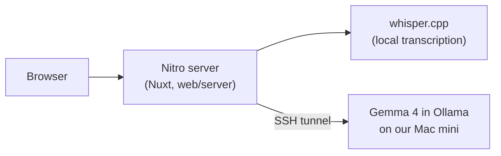

# CallGuard

CallGuard is call-center QA for QA leads and team leads who can't review every call by hand.
It reads a call recording or transcript, scores the agent against the script checklist
(greeting, identity check, required disclosures), flags compliance risks such as a full card
number read aloud, and drafts coaching notes. It all runs on Gemma 4 on our own Mac mini, so
call data never reaches a hosted AI API.

Built in one day at FUTURE FORGE: The ALMA Hackathon, Cebu, 2026-10-22. Live at
https://call.budddy.app.


## What it does

- **Review a call.** Paste a transcript, load a demo call, or upload a recording. A recording
  is transcribed chunk by chunk with whisper.cpp while the page shows each step, Gemma labels
  each line AGENT, CALLER or UNKNOWN, and the QA lead fixes any word or speaker before review.
- **Score it.** Gemma checks the call against the script checklist (`demo/checklist.md`), pass
  or fail per item, each with the line that proves it.
- **Flag risks.** Gemma checks the call against the compliance rules, such as a full card
  number read aloud or account details shared before verifying the caller. Each flag cites
  its transcript line, high severity first, card numbers masked. The
  QA lead confirms or dismisses each one, with an optional note, and has the final say.
- **Coach.** Gemma drafts up to three coaching notes, one of praise and then the top two
  fixes, each tied to a line from the call.
- **See the team.** The Calls list shows each call's flags as confirmed, dismissed or waiting.
  The Agents page ranks agents by high-severity flags not dismissed, then score.
- **Batch review.** Drop many transcripts at once and they're reviewed one after another.
  Recordings aren't reviewed in a batch yet; review them one at a time.
- **Print.** A one-page report to print or save as PDF, card numbers masked as `**** 1111`.

## Why self-hosted

Call recordings hold card numbers, birthdates and addresses. Sending them to a hosted AI or
transcription API means trusting another company with your customers' data, and in many
contact centers that is a compliance problem on its own. CallGuard sends call data only to
our Gemma endpoint, and transcription runs locally with whisper.cpp: no OpenAI, Anthropic or
Google API, no third-party transcription, no analytics.

The **Privacy** page (`/privacy`) is the proof. It logs every request CallGuard's server has
sent since it started, with its destination and size but never its content, and says whether
all of them stayed on our own hardware.

On the demo laptop everything runs locally. The public site at https://call.budddy.app is the
exception: it processes uploads on our VPS, which reaches Gemma over an SSH tunnel to the Mac
mini, so anything uploaded there passes through that VPS.

## How it works



The browser only talks to our own Nitro routes; only the server calls Gemma. Ollama listens on
the Mac mini's `127.0.0.1:11434` and is reached through an SSH tunnel, so it is never exposed
to the internet.

## Run it

You need Node, [pnpm](https://pnpm.io) and an SSH login to the Mac mini (the `personal-vps`
and `macmini` entries in `~/.ssh/config`).

```sh
git clone https://github.com/ReidoBoss/callguard.git
cd callguard
pnpm install                 # git hooks only
cd web && pnpm install       # the app

# Tunnel to Gemma on the Mac mini (CLAUDE.md, Environment, has how to start Ollama)
ssh -f -N -o ExitOnForwardFailure=yes -L 11434:localhost:11434 -J personal-vps macmini
```

Create `web/.env`:

```sh
GEMMA_BASE_URL=http://localhost:11434/v1
GEMMA_MODEL=gemma4:e4b
```

Then `pnpm run dev` in `web/` and open http://localhost:3000. Pick a demo call from
`demo/calls/` on the Review page to see a report.

### Recordings

Transcripts work with the steps above. Uploading audio also needs
[ffmpeg](https://ffmpeg.org) on `PATH` (Windows: `winget install Gyan.FFmpeg`, macOS:
`brew install ffmpeg`) and a local [whisper.cpp](https://github.com/ggml-org/whisper.cpp)
with the `base.en` model:

```sh
git clone https://github.com/ggml-org/whisper.cpp && cd whisper.cpp
cmake -B build && cmake --build build --config Release   # builds build/bin/whisper-cli
sh ./models/download-ggml-model.sh base.en                # downloads models/ggml-base.en.bin, once
```

On Windows the binary lands in `build\bin\Release\whisper-cli.exe`, and the model script is
`models\download-ggml-model.cmd base.en`.

Add both paths to `web/.env` and restart the dev server:

```sh
WHISPER_CLI=/path/to/whisper.cpp/build/bin/whisper-cli
WHISPER_MODEL=/path/to/whisper.cpp/models/ggml-base.en.bin
```

Without them, an upload stops at the transcribe step with "Transcription is not set up here".

`CLAUDE.md` has the rest: starting Ollama on the Mac mini, the deploy, and the team's working
agreement (issues, branches, commits, PRs).

## Not done yet

- **Recordings on the live site** stop at the transcribe step: the server there has no
  whisper.cpp yet (#63). Upload transcripts there, or recordings on the demo laptop.

## Team

| Who | Built |
|---|---|
| Stephen Sagarino Jr. ([@ReidoBoss](https://github.com/ReidoBoss)) | Repo scaffold and tooling, demo calls and answer key, Gemma on the Mac mini, deploy to call.budddy.app, printable report, Gemma scoring, compliance flags and coaching notes, speaker labels |
| Daryllson Jumaoas ([@22104323](https://github.com/22104323)) | Review page, call report, team view, Privacy page, confirming and dismissing flags, transcription progress and transcript fixing, coloring a line by its worst flag |
| John Ron Vincent M. Bacalla ([@johnRonBacalla](https://github.com/johnRonBacalla)) | App shell, recording splitting, whisper.cpp transcription, batch review, flag decisions on the Calls list and team view |
| Angel Khyla Aboloc ([@akmia](https://github.com/akmia)) | Saving and listing reviewed calls |
