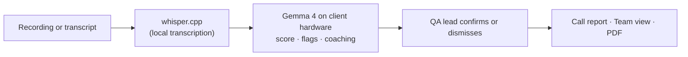

# Project name
Call Buddy

## Team
SDD

## What it does
Call Buddy is call-center QA for QA leads and team leads who can't review every call by hand. It reads a call recording or transcript, scores the agent against the script checklist (greeting, identity check, required disclosures), flags compliance risks such as a full card number read aloud, and drafts coaching notes. It all runs on Gemma 4 on our own Mac mini, so call data never reaches a hosted AI API.

## Demo video
[https://youtu.be/...](https://l.messenger.com/l.php?u=https%3A%2F%2Fdrive.google.com%2Ffile%2Fd%2F1CR43_vAB3rTnWWUj47TqW-70xw9dX-p_%2Fview%3Fusp%3Dsharing&h=AUDgBle73y5VnWZB-ENOmt93RNO9bEIWgeeVmqAR0STQXFEivLImt_O_nlP3OUSas_tPvOnbWrqF6jZfbhRUaqdem3U78Qad4Y2lxdue99wHEFl-qYhv4FcP1fjPG4E)

## Slides
[https://docs.google.com/presentation/...
](https://www.canva.com/design/DAHYt9k9zyA/2nncqswKJiDRzwHyjNEvnw/edit)
## How it works
  - Frontend: Nuxt 4, Vue 3, Tailwind 4, shadcn-vue, TypeScript.
  - Backend: Nitro server routes, with filesystem storage.
  - AI: Gemma 4 on Ollama, self-hosted on a Mac mini and reached over an SSH tunnel. whisper.cpp handles transcription. No hosted AI APIs.
  - Tooling: pnpm, ESLint, husky and commitlint.
  - Deploy: GitHub Actions, Docker, a VPS with Caddy at call.budddy.app.

## How to run it
 # 1. Install (once)
  git clone https://github.com/ReidoBoss/callguard.git call-buddy
  cd call-buddy && pnpm install
  cd web && pnpm install

  # 2. Open the Gemma tunnel (needs your SSH login)
  ssh -f -N -o ExitOnForwardFailure=yes -o ServerAliveInterval=30 \
    -L 11434:localhost:11434 -J personal-vps macmini
  curl -s localhost:11434/v1/models     # should answer

  # 3. Create web/.env (once)
  GEMMA_BASE_URL=http://localhost:11434/v1
  GEMMA_MODEL=gemma4:e4b

  # 4. Run
  pnpm run dev                          # http://localhost:3000

## Business plan
# CallGuard Business Plan

**Private, AI-assisted call quality assurance for Cebu contact centers.**
Every call reviewed. No call data sent to a hosted AI.

| | |
|---|---|
| **Prepared by** | Stephen Sagarino Jr. · Daryllson Jumaoas · John Ron Vincent M. Bacalla · Angel Khyla Aboloc |
| **Event** | FUTURE FORGE: The ALMA Hackathon, Cebu City, Philippines |
| **Date** | 22 October 2026 |
| **Live demo** | https://call.budddy.app |

---

## Contents

1. [Executive summary](#1-executive-summary)
2. [The problem](#2-the-problem)
3. [The solution: CallGuard](#3-the-solution-callguard)
4. [Features](#4-features)
5. [Market analysis](#5-market-analysis)
6. [Competition](#6-competition)
7. [Business model and pricing](#7-business-model-and-pricing)
8. [Go-to-market: reaching Cebu call centers](#8-go-to-market-reaching-cebu-call-centers)
9. [Scaling the business](#9-scaling-the-business)
10. [Financial plan](#10-financial-plan)
11. [Operations and team](#11-operations-and-team)
12. [Risks and how we handle them](#12-risks-and-how-we-handle-them)
13. [Milestones](#13-milestones)
14. [Sources](#14-sources)

---

## 1. Executive summary

CallGuard is quality assurance (QA) software for call centers. It reads a call recording or
transcript, scores the agent against the client's script checklist (greeting, recording
disclosure, identity check, recap, closing), flags compliance risks such as a full card number
read aloud, and drafts coaching notes for the team lead. A QA lead reviews and confirms every
AI flag before it counts.

Our difference is where the AI runs. CallGuard uses **Gemma 4, an open model that runs on
hardware the call center controls**. Recordings and transcripts never go to OpenAI, Google,
Anthropic or any third-party transcription service. For a BPO whose clients are US banks,
insurers and healthcare companies, that removes the main objection to AI-assisted QA: handing
customer data to another company.

> **The opportunity in one paragraph**
>
> The Philippine IT-BPM industry earned about **US$40 billion in 2025 with about 1.9 million
> workers** [1], and contact centers account for about 83% of that revenue [3]. Cebu holds
> about **15% of the national workforce, more than 160,000 full-time employees** [3]. Most
> contact centers still check only about **2–5% of calls by hand** [16][17]. CallGuard lets
> the same QA team see every call, starting with the risky ones.

### What we are asking for

- **Pilot partners:** 3 Cebu contact centers (50–300 seats each) for a free 30-day pilot on
  their own scripts and their own hardware.
- **Introductions:** to CIB.O (Cebu IT-BPM Organization) members and QA, compliance and
  operations heads.
- **Seed funding (proposed):** ₱3.5 million to fund 12 months of a 6-person team, pilot
  hardware and certification work (see [Section 10](#10-financial-plan)).

### Highlights

| Item | Summary |
|---|---|
| Product | Working web app, live at call.budddy.app; built in one day at FUTURE FORGE (22 Oct 2026) |
| Customer | QA leads, team leads and compliance officers in BPOs, captive centers and bank contact centers |
| Model | Per-agent monthly subscription plus a one-time on-premise setup fee |
| Price (proposed) | ₱1,200 per agent per month, against an estimated US$69–100 per agent per month for global tools [19][20] |
| Go-to-market | Cebu IT Park and Cebu Business Park first, through CIB.O, pilots and referrals |
| 3-year target (illustrative) | 40 clients, 5,000 monitored agent seats, about ₱57M annual recurring revenue |

---

## 2. The problem

### 2.1 QA sees only a small slice of calls

A typical QA analyst listens to a handful of calls per agent each month and scores them by
hand. Industry sources put manual coverage at about 2% of interactions, sometimes up to 5%
[16][17]. The other 95–98% of calls are never heard. A serious problem, like an agent reading
a full card number aloud, is found only by luck, or after a client audit or a customer
complaint.

Our demo shows why sampling by score alone fails. Demo call 3 ("Kevin") passes five of six
script items, so a score-based spot check would skip it. It also holds the two most serious
problems in the set: a full card number spoken aloud and a refund promised without approval.

### 2.2 Compliance exposure is real and growing

- **Data Privacy Act of 2012 (RA 10173).** Violations carry imprisonment of six months to
  three years and fines of ₱100,000 to ₱5 million, with heavier penalties for sensitive
  personal information and for cases affecting 100 or more people [12]. The IRR also sets
  duties for outsourcing and subcontracting, which covers BPOs processing data for clients [13].
- **PCI DSS.** A card number spoken on a recorded call counts as stored cardholder data, so
  the recording archive is in scope for audit. Card security codes must never be stored after
  authorization [14][15].
- **Client contracts.** US and EU clients often forbid sending their customers' data to
  unapproved third parties. Many cloud AI QA tools do exactly that.

### 2.3 Cloud AI QA tools are costly and send data off-site

Global conversation-intelligence platforms do automate QA, but they process recordings in
their own cloud and are priced for US budgets: third-party estimates put Observe.AI and
CallMiner at roughly US$69–100+ per agent per month, often with 100-seat minimums and annual
contracts [18][19][20]. For a Cebu center where a QA analyst earns roughly ₱14,000–35,000 a
month [21][22], that price is hard to justify, and the data question often stops the deal.

### 2.4 AI is changing the industry

In July 2026 IBPAP cut its 2028 targets because of AI and global competition. It now projects
US$43.3–50.5 billion in revenue and 1.85–2.14 million workers by 2028, down from US$59 billion
and 2.5 million [4][5]. Cebu centers need to show clients higher quality and lower risk per
seat to keep and win accounts. AI-assisted QA that keeps data private helps them do that.

---

## 3. The solution: CallGuard

CallGuard turns QA from sampling into full coverage, while a person still makes the final
call on every flag.

### 3.1 How it works

1. **Upload** a recording (or a batch) or paste a transcript.
2. **Transcribe locally** with whisper.cpp, split into 30-second chunks. Each line is labelled
   AGENT or CALLER, and the QA lead can fix the transcript before review.
3. **Score** the call against the script checklist with Gemma 4, with the evidence line for
   each pass or fail.
4. **Flag** compliance risks by severity, with sensitive data such as card numbers masked in
   the report.
5. **Coach:** draft coaching notes the team lead can use in the next one-on-one.
6. **Confirm:** the QA lead confirms or dismisses each flag; the decision shows on the calls
   list and the team view.

### 3.2 Privacy by design

- Gemma 4 runs in Ollama on the client's own machine, bound to localhost; it is never exposed
  to the internet.
- The browser never calls the AI directly. Only CallGuard's server does.
- A built-in **Privacy page** logs every outbound request the server has sent, with
  destination and size but never content, and shows whether all of them stayed on the
  client's own hardware.
- No analytics, no hosted AI API, no third-party transcription.

### 3.3 Script checklist and compliance rules (demo defaults)

| Checklist item | Passes when |
|---|---|
| Greeting | Agent greets the caller, says the company name and their own first name |
| Recording disclosure | Agent says the call is recorded before any account details |
| Identity verification | At least two identifiers checked before the account is discussed |
| Purpose confirmed | Agent restates the caller's issue |
| Resolution recap | Agent summarises what was done and what happens next |
| Closing | Agent asks if there is anything else, thanks the caller and closes |

| Compliance rule | Severity |
|---|---|
| Full card number (PAN) read aloud or asked for in full | High |
| Account details discussed before identity is verified | High |
| No recording disclosure before account details | Medium |
| Unauthorised promise (refund, fee waiver, limit change) without approval | Medium |
| Rude, dismissive or blaming language | Low |

---

## 4. Features

### 4.1 Built and working today

Everything below shipped during the hackathon and is in the live demo.

| Feature | What it does for the user |
|---|---|
| Upload or paste | Upload a call recording or paste a transcript |
| Batch review | Review a batch of calls at once |
| Local transcription | whisper.cpp transcribes on our own hardware, with real timestamps |
| Transcription progress and editing | Watch progress and fix the transcript before review |
| Speaker labels | Each transcript line labelled AGENT or CALLER |
| Script scoring | Scores each call against the checklist, with evidence |
| Compliance flags | Flags risks with severity and evidence, masking sensitive data; sorted high first |
| Coaching notes | Drafts coaching notes from the transcript, score and flags |
| Confirm or dismiss flags | A person decides on every AI flag; decisions show on the calls list and team view |
| Call report | Score card, flagged transcript lines and coaching notes on one page |
| Print / PDF | Print or save any call report as a PDF for audits and coaching |
| Saved calls list | Every reviewed call saved and listed on a Calls page |
| Team view | Ranks agents by score and violations |
| Privacy page | Logs every outbound request to prove data stayed on-site |
| Continuous deploy | Every change to `main` is deployed to call.budddy.app automatically |

### 4.2 Next on the roadmap (already planned)

| Feature | Why it matters | When |
|---|---|---|
| Editable checklist and rules (#17) | Each client has its own script; QA leads add, edit and remove items and rules | Pilot (Q4 2026) |
| Taglish and Cebuano-English calls (#18) | Review the calls Cebu agents actually take; quotes kept in the original language, coaching in English | Pilot (Q4 2026) |
| Graceful AI errors (#13) | Timeouts and bad AI output show a clear retry, never a blank page | Pilot (Q4 2026) |
| Live-site transcription (#63) | Upload recordings on the hosted demo, not only on the demo laptop | Q4 2026 |
| Page titles and brand (#64, #62) | Proper titles on every page; possible rename to "Call Buddy" | Q4 2026 |

### 4.3 Proposed features for paying clients

| Feature | Description | Phase |
|---|---|---|
| Multi-client workspaces | One install serves several client accounts (LOBs), each with its own checklist, rules and access | 2027 H1 |
| Logins and roles | Single sign-on; roles for QA analyst, team lead, compliance, operations manager | 2027 H1 |
| Recorder integrations | Pull recordings automatically from the center's call recorder or dialer instead of uploading | 2027 H1 |
| Risk-first queue | Every call scored overnight; QA starts the day on the highest-risk calls | 2027 H1 |
| Calibration mode | Compare AI scores with human scores to tune rules and prove accuracy to clients | 2027 H1 |
| CallGuard Box | A pre-configured on-premise AI server for sites without spare hardware | 2027 H1 |
| Trend dashboards | Compliance and score trends by agent, team, shift and client account | 2027 H2 |
| Coaching tracker | Track whether coaching notes were delivered and whether the agent improved | 2027 H2 |
| Audit export | Evidence packs for client audits, NPC compliance and PCI DSS assessments | 2027 H2 |
| Chat and email QA | Score non-voice interactions with the same checklist | 2028 |
| Near-real-time alerts | Alert a team lead within minutes when a high-severity flag fires | 2028 |

*Phases in 4.3 are proposals and depend on pilot feedback and funding.*

---

## 5. Market analysis

### 5.1 The Philippine IT-BPM industry

| Indicator | Figure | Source |
|---|---|---|
| IT-BPM revenue, 2025 | About US$40 billion (+5% vs 2024) | [1] [2] |
| IT-BPM workforce, 2025 | About 1.9 million (+4% vs 2024) | [1] |
| Contact center share of revenue | About 83% (US$31.6B of US$38B, 2024 data) | [3] |
| Contact center share of workforce | About 88% (2024 data) | [3] |
| 2026 baseline target | US$42B revenue, 1.97M workers | [6] |
| 2028 roadmap (revised Jul 2026) | US$43.3–50.5B revenue, 1.85–2.14M workers | [4] [5] |

### 5.2 Cebu

| Indicator | Figure | Source |
|---|---|---|
| Share of national IT-BPM workforce | About 15% | [3] |
| Cebu IT-BPM full-time employees | More than 160,000 (CCAP, May 2025) | [3] |
| Visayas IT-BPM full-time employees | About 396,000 (34% of national) | [3] |
| Alternative Cebu estimate | 280,000–300,000 FTEs, late 2025 (different counting method) | [7] |
| Industry association | CIB.O (Cebu IT-BPM Organization), 128 member organisations at launch | [8] |
| Flagship event | CIB.O Transformation Summit, 14 Aug 2026, 500+ delegates from 200+ companies | [9] |
| Main hubs | Cebu IT Park and Cebu Business Park | [10] |
| Minimum wage, Cebu (Class A) | ₱582 per day from 14 Oct 2026 | [23] |

*Cebu workforce figures differ by source. This plan uses the more conservative 160,000 figure.*

### 5.3 Market size

We size the market by **agent seats that need QA**, because CallGuard is priced per monitored
agent.

| Level | Definition | Seats | Annual value at ₱1,200/seat/month |
|---|---|---|---|
| TAM | Philippine contact center workforce (88% of ~1.9M) | ~1,670,000 | ~₱24.0 billion |
| SAM | Cebu IT-BPM workforce (conservative) | ~160,000 | ~₱2.3 billion |
| SOM (Year 3) | Cebu seats we aim to serve | 5,000 (~3% of SAM) | ~₱57 million (at blended ₱950) |

*Seat counts are derived from the sources in 5.1 and 5.2. Values are planning estimates, not
forecasts.*

### 5.4 Target customers

| Segment | Examples in Cebu | Why they buy | Priority |
|---|---|---|---|
| Mid-size BPOs (50–500 seats) | Locally owned and regional BPOs in IT Park and Business Park | Can't afford global QA tools; need to win clients on quality | 1 (start here) |
| Financial-services and healthcare accounts | Card support, collections, insurance and health lines | Highest exposure to card data, PCI DSS and the Data Privacy Act | 1 |
| Large multinational BPOs | Concentrix, Teleperformance, TaskUs, Alorica [10][11] | Huge volume; site-level pilots through a QA or compliance champion | 2 |
| Captive centers and GCCs | In-house centers of foreign banks and tech firms | Strict data rules; prefer on-premise | 2 |
| Local enterprises | Banks, telcos, utilities and hospitals with own hotlines | Data Privacy Act duties; Cebuano and Taglish calls | 3 |

### 5.5 Who uses it and who pays

- **Users:** QA analysts, team leads, compliance officers.
- **Buyers:** QA managers, operations directors, site directors, data protection officers
  (DPOs), and the client's account owner.
- **Influencers:** IT and security teams, who must approve any new data processing, which is
  where on-premise AI wins.

---

## 6. Competition

| Option | Strengths | Weaknesses | CallGuard's edge |
|---|---|---|---|
| Manual QA (spreadsheets) | Cheap, familiar, human judgement | Covers ~2–5% of calls; slow; inconsistent between analysts | Reviews every call; QA focuses on judgement |
| Global cloud platforms (Observe.AI, CallMiner, NICE) | Mature, feature-rich, real-time | US$69–100+/agent/month; data processed in vendor cloud; 100-seat minimums | On-premise, local price, no minimum seats |
| Built-in recorder analytics | Already installed | Basic keyword spotting; weak on scripts and coaching | Script scoring, evidence and coaching notes |
| Generic chatbots (ChatGPT etc.) | Easy to try | Sends customer data to a third party; no workflow or audit trail | Private, structured, auditable |

### Our advantages

1. **Privacy you can prove:** on-premise AI and a Privacy page that logs every outbound request.
2. **Built for Cebu:** local team, local pricing, Taglish and Cebuano-English support on the roadmap.
3. **Human in the loop:** every flag is confirmed or dismissed by a person, which matters for
   fair coaching and labour relations.
4. **Low cost to run:** open models on modest hardware; no per-minute cloud transcription fees.

---

## 7. Business model and pricing

### 7.1 Pricing (proposed)

| Plan | Who it is for | Price | Includes |
|---|---|---|---|
| Pilot | Any Cebu contact center | Free for 30 days | Up to 25 agents, their own scripts, setup on their hardware, weekly check-ins |
| Team | 10–100 agents | ₱1,200 / agent / month | All current features, editable checklists, email support |
| Site | 101–500 agents | ₱1,000 / agent / month | Multi-client workspaces, logins and roles, recorder integration, calibration |
| Enterprise | 500+ agents or multi-site | Custom (from ₱800) | Dedicated support, audit exports, SLA, security review support |
| Setup fee | All paid plans | ₱150,000 one-time | On-premise install, checklist set-up, QA team training |
| CallGuard Box (optional) | Sites without spare hardware | Hardware at cost + 15% | Pre-configured AI server, installed on site |

*Prices are proposals to test during pilots. Billed annually; monthly billing at +10%.*

### 7.2 Value to the customer

A Team-plan seat costs ₱14,400 a year. A 100-agent account costs ₱1.44 million a year, or about
₱120,000 a month: roughly the monthly cost of four QA analysts at ₱25,000–35,000 [21].
CallGuard does not replace those analysts; it lets the same team review every call instead of
a sample and spend its time on the calls that matter. One avoided client penalty, lost account
or Data Privacy Act case, with fines of up to ₱5 million [12], pays for years of service.

> **Price check.** At about ₱58 to the US dollar (our assumption), ₱1,200 is about **US$21 per
> agent per month**, against **US$69–100+** estimated for global platforms [19][20].

### 7.3 Revenue streams

- Recurring per-agent subscriptions (main stream, about 90% of revenue by Year 3).
- One-time setup and training fees.
- Optional CallGuard Box hardware.
- Custom checklist and rule packs for regulated accounts (banking, healthcare, collections).

---

## 8. Go-to-market: reaching Cebu call centers

### 8.1 Our approach

Sales to contact centers are relationship-driven and security-reviewed. We win by **proving
value on the prospect's own calls, on their own hardware**, so the data never leaves their
site, not even to us.

### 8.2 Phase 1: Cebu pilots (Nov 2026 – Mar 2027)

1. **Build a target list of 60 Cebu contact centers** in Cebu IT Park, Cebu Business Park,
   Mandaue and Lapu-Lapu, sorted by size and account type (finance and healthcare first).
2. **Find the champion:** contact QA managers, compliance heads and DPOs on LinkedIn and
   through our hackathon network. Message: "See 100% of your calls, with zero data leaving
   your building."
3. **Join CIB.O** as a startup member, and contact CCAP (Contact Center Association of the
   Philippines) for introductions to member companies.
4. **Run 3 free pilots** of 30 days each, on 25 agents, with the client's script. Measure calls
   covered, flags confirmed and QA hours saved.
5. **Publish results** as case studies (with permission) and convert at least 2 pilots to paid
   plans.

### 8.3 Phase 2: Cebu growth (Apr 2027 – Dec 2027)

- **Events:** exhibit or speak at the next CIB.O summit (the 2026 edition drew 500+ delegates
  from 200+ companies [9]), plus ICT and data privacy events in Cebu.
- **QA community:** free monthly "QA Leaders Cebu" meetups and workshops on the Data Privacy
  Act and PCI DSS for QA teams.
- **Referrals:** one month free for each referral that signs; QA managers move between
  companies often and take tools with them.
- **Partners:** IT resellers and system integrators who already install recorders and dialers
  for Cebu BPOs; 15–20% referral margin.
- **Universities:** internships with Cebu schools such as USC, CIT-U and UC for engineering and
  QA-annotation talent.
- **Content:** a short monthly "Cebu QA compliance" newsletter and a free checklist template
  library.

### 8.4 Sales funnel targets (Year 1, illustrative)

| Stage | Target | Conversion |
|---|---|---|
| Centers contacted | 60 | – |
| Discovery meetings | 20 | 33% |
| Pilots run | 6 | 30% |
| Paying clients | 4 | 67% |

### 8.5 Outreach message

> **Subject:** Review every call, without sending recordings to the cloud
>
> Hi [Name], we are a Cebu team building CallGuard, AI-assisted QA that runs on your own
> servers. It scores every call against your script, flags risks like card numbers read aloud,
> and drafts coaching notes, and your QA team confirms every flag. Could we run a free 30-day
> pilot on 25 of your agents? Your recordings never leave your building. Do you have 15 minutes
> this week for a demo?

---

## 9. Scaling the business

### 9.1 Geographic expansion

| Stage | Market | Timing | How |
|---|---|---|---|
| 1 | Metro Cebu (Cebu City, Mandaue, Lapu-Lapu) | 2026–2027 | Pilots, CIB.O, direct sales |
| 2 | Rest of Visayas (Iloilo, Bacolod, Dumaguete) | 2027–2028 | Referrals from multi-site clients; partner resellers |
| 3 | Metro Manila, Clark, Davao | 2028 | Sales hire in Manila; enterprise accounts |
| 4 | Export (India, Latin America, US clients of our BPOs) | 2029+ | Sell through BPO head offices and their clients |

### 9.2 Product and technical scaling

- **From one Mac mini to many sites:** package CallGuard as a single container plus Ollama,
  installed per site in under a day.
- **Hardware tiers:** small sites on a compact AI workstation; large sites on a GPU server that
  reviews thousands of calls per night.
- **Model choice:** stay on open models (Gemma 4 today) so clients keep control and we avoid
  per-call API costs.
- **Languages:** English first, then Taglish and Cebuano-English, then other Philippine
  languages.
- **Security certifications:** ISO/IEC 27001 readiness and an NPC-aligned privacy programme by
  2027, to pass enterprise security reviews.

### 9.3 Team growth

| Role | Now | End 2027 | End 2028 |
|---|---|---|---|
| Founders / engineering | 4 | 6 | 10 |
| Customer success and onboarding | 0 | 2 | 5 |
| Sales and partnerships | 0 | 1 | 3 |
| QA and compliance specialist | 0 | 1 | 2 |
| **Total** | **4** | **10** | **20** |

---

## 10. Financial plan

The figures below are illustrative planning estimates based on our proposed pricing. They will
be updated after the first pilots.

### 10.1 Key assumptions

- Blended price per seat: ₱1,100 (Year 1), ₱1,000 (Year 2), ₱950 (Year 3), as larger clients
  get volume pricing.
- Average client size: 75 seats (Year 1), 100 seats (Year 2), 125 seats (Year 3).
- Setup fee ₱150,000 per new client; churn 10% per year from Year 2.
- Clients run CallGuard on their own hardware, so our hosting cost per client is close to zero.

### 10.2 Three-year projection

| | Year 1 (2027) | Year 2 (2028) | Year 3 (2029) |
|---|---|---|---|
| Paying clients (end of year) | 4 | 15 | 40 |
| Monitored seats (end of year) | 300 | 1,500 | 5,000 |
| Annual recurring revenue (end of year) | ₱3.96M | ₱18.0M | ₱57.0M |
| Setup fees | ₱0.60M | ₱1.65M | ₱3.75M |
| Recognised revenue (approx.) | ₱2.6M | ₱12.5M | ₱41.0M |
| Operating costs | ₱4.2M | ₱11.0M | ₱27.0M |
| **Operating result** | **–₱1.6M** | **₱1.5M** | **₱14.0M** |

*Recognised revenue assumes seats are added evenly through each year. Operating costs are
mainly salaries, pilot hardware, sales and events, and certification.*

### 10.3 Use of seed funding (₱3.5M, proposed)

| Use | Amount | Share |
|---|---|---|
| Team (6 people, 12 months, modest startup salaries) | ₱2.10M | 60% |
| Pilot hardware (3 AI workstations loaned to pilot sites) | ₱0.60M | 17% |
| Security and privacy programme (ISO 27001 readiness, legal, NPC registration) | ₱0.35M | 10% |
| Sales, events and CIB.O membership | ₱0.25M | 7% |
| Contingency | ₱0.20M | 6% |
| **Total** | **₱3.50M** | **100%** |

### 10.4 Break-even

At about ₱1,000 per seat and Year-2 costs of ₱11.0M, CallGuard breaks even at roughly **920
monitored seats**, or about 9–10 mid-size clients. We expect to reach this during Year 2.

---

## 11. Operations and team

### 11.1 Founding team

| Name | Role | Built in CallGuard |
|---|---|---|
| Stephen Sagarino Jr. | Infrastructure and AI | Repo and tooling, demo calls and answer key, Gemma on the Mac mini, deployment, printable report |
| Daryllson Jumaoas | Product and front end | Review page, call report, team view, Privacy page |
| John Ron Vincent M. Bacalla | Audio and pipeline | App shell, recording splitting, whisper.cpp transcription, batch review |
| Angel Khyla Aboloc | Data and back end | Saving and listing reviewed calls |

*Roles beyond the hackathon are proposed and open to change.*

### 11.2 How we deliver

- **Install:** one-day on-site setup: container, Ollama and model, recorder connection.
- **Onboard:** turn the client's script and rules into a checklist, then a calibration week
  comparing AI scores with their QA team's.
- **Support:** remote support only with the client's permission and without access to call
  content; updates delivered as signed container images.

### 11.3 Technology

| Layer | Choice |
|---|---|
| Web app | Nuxt 4 (Vue), Tailwind, shadcn-vue |
| Server | Nitro server routes; the only component that talks to the AI |
| AI model | Gemma 4 (open weights) served by Ollama, on client hardware |
| Transcription | whisper.cpp, local, with real timestamps |
| Deployment | Docker container with ffmpeg; automated deploy from GitHub |

---

## 12. Risks and how we handle them

| Risk | Impact | Mitigation |
|---|---|---|
| AI makes a wrong flag or misses one | Unfair coaching; lost trust | A person confirms every flag; evidence quotes on every flag; calibration mode; demo answer key as a regression test |
| Accents, Taglish and Cebuano | Lower transcription and scoring accuracy | Transcript editing before review; Taglish test set; tune on pilot data, on site |
| Long enterprise sales cycles | Slow revenue | Start with mid-size BPOs; free pilots; partner resellers |
| Security reviews | Deals stall | On-premise by default; Privacy page; ISO 27001 readiness; documentation ready for DPOs |
| Industry slowdown from AI | Fewer seats in some accounts | Price per monitored seat, not per QA analyst; extend to chat and email QA |
| Global vendors cut prices | Pricing pressure | Compete on data control, local support and language, not only price |
| Client hardware limits | Slow reviews | Hardware tiers; CallGuard Box; overnight batch processing |

---

## 13. Milestones

| When | Milestone |
|---|---|
| 22 Oct 2026 | Working product demoed at FUTURE FORGE; live at call.budddy.app |
| Nov 2026 | Editable checklists, Taglish support and error handling shipped; target list of 60 centers |
| Dec 2026 | CIB.O membership; first 2 pilots signed |
| Q1 2027 | 3 pilots complete; 2 converted to paid; first case study |
| Q2 2027 | Logins and roles, multi-client workspaces, recorder integration; seed round closed |
| Q3 2027 | Exhibit at the CIB.O summit; 4+ paying clients, 300 seats |
| 2028 | 15 clients, 1,500 seats; break-even; expansion to Iloilo and Bacolod |
| 2029 | 40 clients, 5,000 seats; Manila office |

### Next 30 days

1. Finish the pilot features (editable checklist, Taglish, error handling).
2. Write a one-page security and privacy brief for DPOs.
3. Contact 20 Cebu QA and compliance leads; book 5 demos.
4. Apply for CIB.O membership and ask for member introductions.

---

## 14. Sources

Market data was gathered on 22 October 2026. Vendor statistics (QA coverage, competitor
pricing) come from interested parties and third-party estimates, and are used as indications,
not exact figures.

1. [IBPAP 2025 results: ~US$40B revenue, ~1.9M workers (Inquirer, Jan 2026)](https://business.inquirer.net/567026/it-bpm-industry-in-ph-outpaced-global-growth-in-2025)
2. [IT-BPM sector earns US$40 billion in 2025 (Manila Times, Dec 2025)](https://www.manilatimes.net/2025/12/31/business/top-business/it-bmp-sector-earns-40-billion-in-2025/2251247)
3. [Cebu solidifies lead in IT-BPM boom: Cebu 15% of workforce, 160,000+ FTEs (SunStar, 28 May 2025)](https://www.sunstar.com.ph/cebu/cebu-solidifies-lead-in-it-bpm-boom)
4. [AI, global competition force IT-BPM industry to cut targets (BusinessWorld, Jul 2026)](https://bworldonline.com/top-stories/2026/07/15/763409/ai-global-competition-force-philippines-it-bpm-industry-to-cut-targets/)
5. [IT-BPM sector eyes US$50.5B revenue, 2.14M jobs by 2028 (Context.ph, Sep 2026)](https://context.ph/2026/09/23/it-bpm-sector-eyes-50-5b-revenue-2-14m-jobs-by-2028/)
6. [Philippines IT-BPM industry eyes sustained growth in 2026 (The Freeman, Jan 2026)](https://www.philstar.com/the-freeman/cebu-business/2026/01/06/2499092/philippines-it-bpm-industry-eyes-sustained-growth-2026)
7. [Cebu's IT-BPM sector is automating faster than it can hire (Kitalent)](https://kitalent.com/articles/cebu-it-bpm-skills-chasm)
8. [CEDF-IT evolves into CIB.O, 128 member organisations (Cebu Daily News, 2017)](https://cebudailynews.inquirer.net/134004/keeping-pace-demands-cedf-evolves-cib-0)
9. [CIB.O Transformation Summit 2026, 14 Aug 2026, 500+ delegates (Ramco event page)](https://www.ramco.com/transforming-hr-payroll-with-ai-at-transformation-summit-cebu-2026)
10. [Top BPO companies in Cebu (Bossjob, 2026)](https://bossjob.ph/blog/remote-working/8619/bpo-companies-in-cebu/)
11. [Teleperformance opens new site in Cebu City (Newswire)](https://www.newswire.com/view/content/teleperformance-philippines-opens-new-site-in-cebu-city-103562)
12. [Data Privacy Act penalties: 6 months to 3 years, ₱100,000 to ₱5M (BusinessWorld)](https://www.bworldonline.com/?p=159555)
13. [IRR of RA 10173, as amended (National Privacy Commission)](https://privacy.gov.ph/wp-content/uploads/2023/06/IRR_RA-10173-as-amended.pdf)
14. [Telephone payments and PCI DSS (Paytia)](https://www.paytia.com/resources/compliance-101/telephone-payments-pci-dss)
15. [PCI DSS for contact centers (NICE)](https://www.nice.com/glossary/pci-dss)
16. [Every conversation, not a sample: ~2% of interactions reviewed (Avaamo)](https://blog.avaamo.com/blog/every-conversation-not-a-sample)
17. [AI quality assurance for call centers: manual QA covers 2–5% (Aircall)](https://aircall.io/blog/ai-quality-assurance-call-center/)
18. [Conversation intelligence and auto-QA pricing (Call Centre Helper)](https://www.callcentrehelper.com/conversation-intelligence-auto-qa-cost-237154.htm)
19. [Observe.AI pricing (CloudTalk, Jun 2026)](https://www.cloudtalk.io/blog/observe-ai-pricing/)
20. [CallMiner guide and pricing estimate (Macha)](https://www.getmacha.com/blog/callminer-complete-guide)
21. [QA analyst job listing, Cebu, ₱25–35K/month (Bossjob)](https://bossjob.ph/en-us/job/qa-specialist-cebu-361177)
22. [QA specialist job listing, Cebu (Bossjob)](https://bossjob.ph/en-us/job/qa-specialist-cebu-413691)
23. [Central Visayas wage hike takes effect, ₱582/day Class A (Daily Tribune, 14 Oct 2026)](https://tribune.net.ph/2026/10/14/central-visayas-wage-hike-takes-effect-dole)

