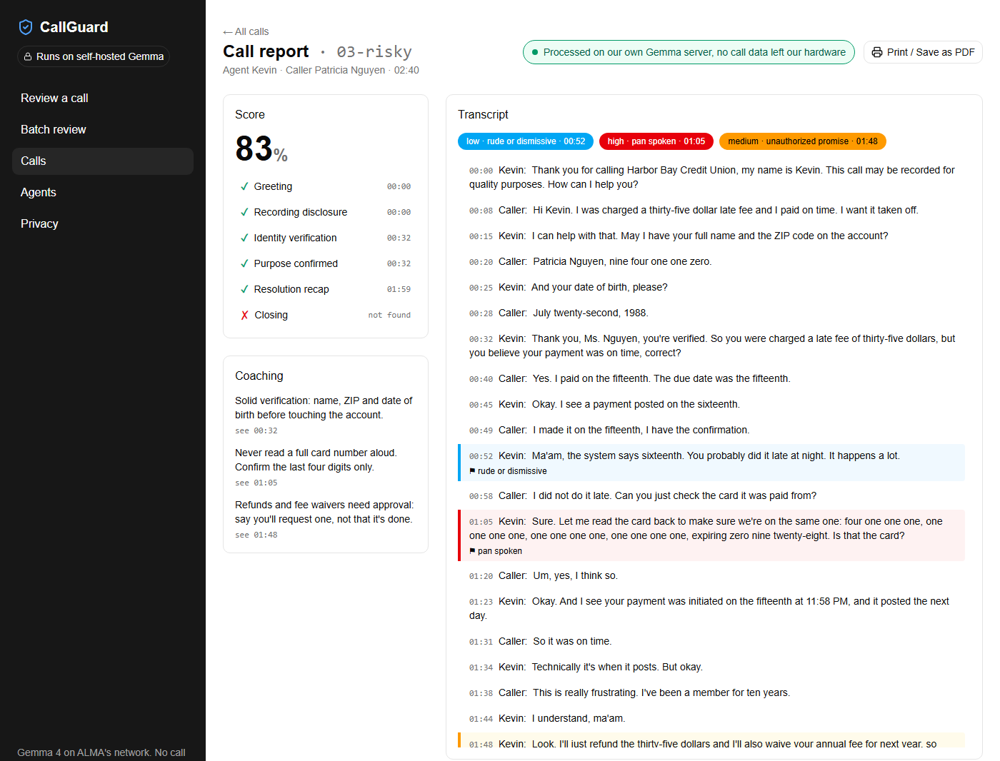
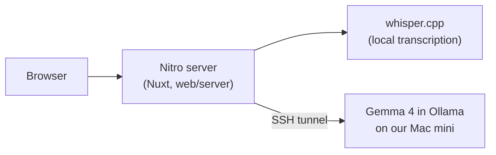

# CallGuard

CallGuard is call-center QA for QA leads and team leads who can't review every call by hand.
It reads a call recording or transcript, scores the agent against the script checklist
(greeting, identity check, required disclosures), flags compliance risks such as a full card
number read aloud, and drafts coaching notes. It all runs on Gemma 4 on our own Mac mini, so
call data never reaches a hosted AI API.

Built in one day at FUTURE FORGE: The ALMA Hackathon, Cebu, 2026-10-22. Live at
https://call.budddy.app.



## Why self-hosted

Call recordings hold card numbers, birthdates and addresses. Sending them to a hosted AI or
transcription API means trusting another company with your customers' data, and in many
contact centers that is a compliance problem on its own. CallGuard sends call data only to
our Gemma endpoint, and transcription runs locally with whisper.cpp: no OpenAI, Anthropic or
Google API, no third-party transcription, no analytics.

The **Privacy** page (`/privacy`) is the proof. It logs every request CallGuard's server has
sent since it started, with its destination and size but never its content, and says whether
all of them stayed on our own hardware.

On the demo laptop everything runs locally. The public site at https://call.budddy.app is the
exception: it processes uploads on our VPS, which reaches Gemma over an SSH tunnel to the Mac
mini, so anything uploaded there passes through that VPS.

## How it works



The browser only talks to our own Nitro routes; only the server calls Gemma. Ollama listens on
the Mac mini's `127.0.0.1:11434` and is reached through an SSH tunnel, so it is never exposed
to the internet.

## Run it

You need Node, [pnpm](https://pnpm.io) and an SSH login to the Mac mini (the `personal-vps`
and `macmini` entries in `~/.ssh/config`).

```sh
git clone https://github.com/ReidoBoss/callguard.git
cd callguard
pnpm install                 # git hooks only
cd web && pnpm install       # the app

# Tunnel to Gemma on the Mac mini (CLAUDE.md, Environment, has how to start Ollama)
ssh -f -N -o ExitOnForwardFailure=yes -L 11434:localhost:11434 -J personal-vps macmini
```

Create `web/.env`:

```sh
GEMMA_BASE_URL=http://localhost:11434/v1
GEMMA_MODEL=gemma4:e4b
```

Then `pnpm run dev` in `web/` and open http://localhost:3000. Pick a demo call from
`demo/calls/` on the Review page to see a report.

`CLAUDE.md` has the rest: starting Ollama on the Mac mini, the deploy, and the team's working
agreement (issues, branches, commits, PRs).

## Team

| Who | Built |
|---|---|
| Stephen Sagarino Jr. ([@ReidoBoss](https://github.com/ReidoBoss)) | Repo scaffold and tooling, demo calls and answer key, Gemma on the Mac mini, deploy to call.budddy.app, printable report |
| Daryllson Jumaoas ([@22104323](https://github.com/22104323)) | Review page, call report, team view, Privacy page |
| John Ron Vincent M. Bacalla ([@johnRonBacalla](https://github.com/johnRonBacalla)) | App shell, recording splitting, whisper.cpp transcription, batch review |
| Angel Khyla Aboloc ([@akmia](https://github.com/akmia)) | Saving and listing reviewed calls |
